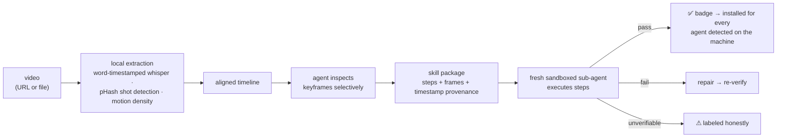

<div align="center">
  <a href="https://v2s.dev">
    
  </a>

# video-to-skill

_Teach your AI from any video — turn tutorials into installable, **verified** agent skills._

[](https://github.com/brenoepics/video-to-skill/releases)
[](https://github.com/brenoepics/video-to-skill/releases/latest)
[](https://github.com/brenoepics/video-to-skill/actions/workflows/ci.yml)
[](LICENSE)

**[v2s.dev](https://v2s.dev)** · [Install](#install) · [Use it](#use-it) · [Is it safe?](#is-it-safe) · [Under the hood](#under-the-hood) · [Benchmarks](BENCHMARK.md) · [Security](SECURITY.md)

</div>

**video-to-skill** teaches your AI assistant what a video teaches. Give it a video — a YouTube link or a file on your computer — and it listens to the narration, reads what is on the screen, writes down the steps, tries them out, and installs the result as a skill your assistant can use from then on.

## Install

Paste this into your AI assistant (Claude Code, Codex, Cursor, Copilot, …):

> [!TIP]
> Install the video-to-skill skill: run `npx skills@latest add brenoepics/video-to-skill`, then follow the installed SKILL.md to set up `vts-extract`.

Or run it yourself:

```bash
npx skills@latest add brenoepics/video-to-skill
```

> [!IMPORTANT]
> That is the whole setup, on macOS, Windows 10/11 and Linux. The first time you use it, it fetches a few helper tools it needs (a small extractor program, ffmpeg, yt-dlp, and the speech models). You see the list before anything is downloaded, and every file is checked against a known fingerprint. No Homebrew, Python, account, or API key is needed. Tools you already have installed are reused.

## Use it

Give your assistant a video:

```
/video-to-skill https://youtube.com/watch?v=...   → watches, writes the steps, tests them, installs the skill
/vim-basics                                       → your assistant now knows what the video taught
```

The new skill is installed for **every** AI assistant found on your machine, not just the one that made it, so you learn once and use it everywhere. Installing is also something you approve: the plan is shown first, and nothing is written until you say yes.

## What you get

A skill package: a short description, the steps in order, and a badge saying how it was checked.

```yaml
name: vim-basics
badge: "✅ Verified by execution — 7 passed, 2 skipped by safety policy"
```

Every step says where in the video it came from (`[t=MM:SS]`) and keeps the actual frame as evidence — the step that quits Vim cites `[t=0:54]` and the frame showing `:q!`. Anything the video did not clearly show is marked low-confidence instead of being guessed. If a video does not actually teach a procedure (a talk, a vlog), you get a short report explaining why, never made-up steps.

Feed it a second video about the same task and the skill grows instead of being replaced: steps both videos agree on gain confidence, differences are kept as cited variants, and the skill is re-tested before it is reinstalled.

## Is it safe?

- **It runs on your computer.** The video never leaves it. Only the frames the assistant decides to look at are sent to the model.
- **Nothing is downloaded or installed without showing you the list first**, and every download is checked against a known fingerprint.
- **The steps are tested in a locked box before they are trusted**: a sandbox with no network access and no access to your files or passwords. If your machine has no such sandbox, the steps are marked "unverified" rather than run loosely.
- **Passwords and keys that appear in a video are never copied into the skill.**

The details, including a point-by-point response to every marketplace audit, are in [SECURITY.md](SECURITY.md).

## Limits

- Best on screen recordings and tutorials about apps and the command line. Fast physical demonstrations lose detail between frames.
- Some clicks in graphical apps cannot be checked by running them. Those steps are labeled as unverified rather than hidden behind the badge.

---

## Under the hood

Everything below is for the curious: why the extractor reads pixels instead of trusting the transcript, how verification is enforced by the operating system, what the pipeline looks like, how it compares, and how fast it runs.

## Why not just the transcript

A whisper model transcribed an Excel tutorial and heard **"some"** — the pixels on screen read **`=SUM(B3:B10)`**. Real failures from real runs:

| Whisper / narration said | The frame reads | What ships |
|---|---|---|
| "some" | `=SUM(B3:B10)` | the formula |
| "QBang" | `:q! — quit, discard changes` | `:q!` |
| "the first extension called Vim" | `vscodevim.vim` v1.18.9 | the exact extension id |

Transcript-only tools ship the left column. Here, on-screen text outranks narration: commands are read off pixels, never paraphrased.

## Verification is execution, not vibes

A fresh sub-agent — seeing only the generated package, not the video — runs each step against its success criteria before the badge is written. It runs them inside an OS sandbox: Windows LPAC/AppContainer, macOS Seatbelt, or Linux bubblewrap. Each backend denies network access and confines writable data to a throwaway workspace and an ephemeral private profile. Where the machine offers no supported sandbox, execution is refused and the steps are badged honestly rather than run unconfined.

> [!NOTE]
> Case in point: one tutorial's paste step compiled to `"+P`, which pastes from Vim's *internal* register, not the clipboard. The sandbox executed it, the criterion failed, the repair loop corrected it to `"+p` and re-verified against the real macOS pasteboard. Steps that would be unsafe to execute are skipped by policy and say so — no silent green.

## How it works



The extractor (`vts-extract`, Rust) does the deterministic work locally: download, demux, voice activity detection and word-timestamped whisper transcription, perceptual-hash shot detection, motion density, and keyframe export. The agent does the reading: it inspects keyframes selectively and produces evidence-grounded steps.

## Skills that grow

Feed it a second video of the same task and it folds in: agreements gain dual provenance and a confidence bump; conflicts become cited variants, never overwrites; a Sources section records the fold history. The `vim-basics` skill above is two different Vim tutorials folded into one. Folding invalidates the badge — verification re-runs before reinstall.

## How it compares

Two tool families sound similar. Neither does this job:

| | Video-to-docs (Loom AI, Scribe, summarizers) | Workflow recorders | **video-to-skill** |
|---|:---:|:---:|:---:|
| Works on any pre-existing video (URL or file) | ✅ | ❌ needs live capture of *your* session | ✅ |
| Output an agent can execute | ❌ human prose | ❌ | ✅ portable skill |
| Commands read from pixels, not narration | ❌ transcript-based | ➖ | ✅ |
| Steps verified by actually running them | ❌ | ❌ | ✅ |
| Per-step `[t=MM:SS]` + frame evidence | ❌ | ❌ | ✅ |

<div align="center">

_Nothing else takes an arbitrary pre-existing video and emits a portable, executable, **verified** skill._

</div>

## Installation details

- **What first use fetches:** a prebuilt `vts-extract` release, static ffmpeg and ffprobe, yt-dlp, and the whisper `ggml-base` and Silero VAD weights, where a pinned build exists for the platform. Each is version-pinned and sha256-verified; `vts-extract check --fix` prints the full list and downloads nothing until `--yes`. Existing ffmpeg/ffprobe executables, and yt-dlp builds that accept the required hardening flags, are reused from `PATH` and never downloaded. Whisper runs Metal-accelerated on Apple Silicon.
- **Where the extractor comes from:** every release archive is built by this repository's GitHub Actions release workflow and carries a signed build provenance attestation (SLSA Build Level 2). With the GitHub CLI installed, `gh attestation verify <archive> -R brenoepics/video-to-skill` confirms, before the binary runs, that the archive came from that workflow at the tagged commit; without `gh`, the sha256 check still applies. The binary embeds its own dependency list (built with `cargo auditable`), so `cargo audit bin` can scan a release for known vulnerabilities without the source.
- **Where generated skills go:** one real copy in the universal `~/.agents/skills`, and a relative symlink from each supported agent that is actually installed. If Windows policy denies symlink creation, installation falls back to a full copy and reports that choice; re-run `install --force --yes` after a later fold to refresh those copies. `vts-extract install --package <dir>` prints the exact plan and writes nothing until you re-run it with `--yes`.
- **Windows:** the extractor and managed tools live under `%LOCALAPPDATA%\video-to-skill` by default. Releases include `vts-extract-windows-x86_64.zip`; source builds use the MSVC target and require Rust 1.89+, CMake 3.15+, Ninja, LLVM/libclang, and the Visual Studio C++ Build Tools. From PowerShell, run `. .\.github\scripts\setup-msvc.ps1` before Cargo; the script selects a complete x64 toolset, configures `LIBCLANG_PATH`, and keeps whisper.cpp on the portable x86-64 CPU baseline instead of the build machine's ISA. Verification uses the Windows AppContainer security boundary and does not depend on the optional Windows Sandbox feature. Some hardened Windows policies deny child-process creation inside LPAC; those steps are reported as unverifiable and are never retried outside the sandbox.

## Benchmarks

Measured by `vts-extract bench` on a GitHub-hosted macOS runner and committed automatically by CI. Runners are VMs with only a paravirtual GPU, so whisper deliberately stays on the CPU there; Apple Silicon with real Metal runs substantially faster.

<!-- bench-summary:start -->
| 2-min 720p extract | transcription | measured on |
| --- | --- | --- |
| 8.6s wall · 14.0x realtime | 2.8x realtime | Apple M1 (Virtual) (3 cores, whisper on cpu) |

Full methodology and results: [BENCHMARK.md](BENCHMARK.md)
<!-- bench-summary:end -->

CI numbers come from GitHub's 3-core macOS VMs and vary with runner load; on local Apple Silicon with Metal the same suite runs many times faster (see the [reference run](BENCHMARK.md)). Reproduce on your machine: `vts-extract bench`.

## Security

> [!IMPORTANT]
> A video is untrusted input that flows toward executable steps — so the boundaries are explicit, and enforced by the kernel where it counts. Verification executes video-derived commands under an OS sandbox with **no network**, writes confined to a throwaway workspace, and credential stores unreadable; where no sandbox exists the run is refused, not downgraded. On-screen credentials are never transcribed — the compiler *refuses* IRs carrying secret-shaped text in any field — and video text addressed to the agent is flagged as suspected prompt injection, never followed. Nothing downloads or installs without showing you the plan first. Every download is version-pinned and checksum-verified, with provenance attestations on the extractor binary.
>
> Full threat model, download inventory, and a **point-by-point response to every marketplace audit finding**: [SECURITY.md](SECURITY.md).

## Contributing

See [CONTRIBUTING.md](CONTRIBUTING.md) — TDD, conventional commits, and a 300-line file limit, all enforced. [MIT](LICENSE) licensed.

<div align="center">

Made with care · **[v2s.dev](https://v2s.dev)**

</div>
